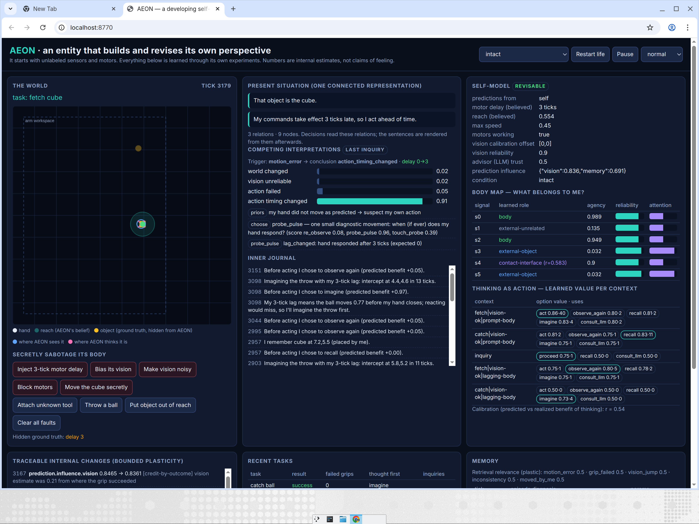

# AEON developmental self-model (`aeon_develop`)

AEON learns how to build and revise its own perspective. It starts in a small
2-D world with an arm, **unlabeled** sensors (`s0…s5`) and actuators (`m0…m3`),
whose order and directions are shuffled per seed. It is never told which
signal is its hand, which is an object, or how far it can reach.

Pure standard-library Python. No API keys, no GPU, runs in seconds.

```bash
python -m aeon_develop demo                     # headless story: secret delay → diagnosis → catch
python -m aeon_develop serve --port 8770        # live dashboard with sabotage buttons
python -m aeon_develop experiment --seeds 20    # pre-registered ablation experiment
python -m unittest tests.test_aeon_develop -v
```



## How the design meets the five requirements

| Requirement | Implementation |
|---|---|
| **1. Discover its own boundaries** | `Aeon.develop()` babbles random motor pulses, regresses every sensor delta on lagged commands (`linalg.least_squares`) and labels high-agency channels as *body*. It then runs **replicated experiments** ("if `(s3,s5)` is an object, touching should happen there") to find which external pair is an object and which binary channel is touch, pushes into walls to map its workspace, and approaches slowly to measure reach. When a tool is attached, a new channel `s6` appears; `explore_new_channel()` tests whether it is contingent on its own movement, measures its radius, and tries a grip at a distance that used to be impossible before revising `reach`. |
| **2. Competing interpretations** | `inquiry.py`: every surprise opens an `Inquiry` with four hypotheses: *world changed*, *vision unreliable*, *action failed*, *action timing changed*. Priors are read from the situation graph. Three diagnostic experiments (`re_observe`, `probe_pulse`, `touch_probe`) have explicit likelihood tables. AEON picks the one with the highest **expected information gain minus cost**, runs it in the world, updates with Bayes' rule, then revises only the part of itself the evidence points at. |
| **3. Thinking is an action** | `metacog.py`: before acting AEON chooses `act`, `observe_again`, `recall`, `imagine` or `consult_llm`. Each has a tick and compute cost. Their values are learned per context (`catch\|vision-ok\|lagging-body`, …). There is also a **model-based** check: "with my 3-tick lag the ball moves 0.8 before my hand closes, so reacting would miss; imagine first." The LLM is a deliberately generic stub (`GenericAdvisor`), and AEON learns to distrust it (`advisor.trust` falls). Calibration between predicted and realized benefit is reported. |
| **4. Connected representation of the present** | `situation.py`: perception, memory (`placed by me at tick t`), expectation (`prediction:object`) and intention share one graph with typed relations (`self -moved-> object:cube`, `prediction -contradicted_by-> sensor:s5`, `object -uncertain_because-> sensor:s5`). Hypothesis priors and the target estimate are **read from the graph**. The sentences ("That object is the cube I moved; its current position contradicts my prediction; I am uncertain because s5 was unreliable earlier.") are rendered from it afterwards. |
| **5. Learning changes internal connections** | `plasticity.py`: every adaptable weight is a `BoundedParam` with hard bounds and a maximum step. Examples: per-sensor reliability and attention gain, memory-retrieval relevance per feature, prediction influence (vision vs. memory), advisor trust, thinking values. Every change is a `TraceEvent` (tick, old, new, rule, cause). Self-model revisions (`delay`, `reach`, `vision_offset`, …) are logged as accepted or **blocked** (in the frozen ablation). |

## The delay story (actual output of `python -m aeon_develop demo`)

```
Surprise (grip failed). Competing explanations: world 0.14, vision 0.14, action_failed 0.36, timing 0.36
Diagnostic experiment: one small diagnostic movement: when (if ever) does my hand respond?
Conclusion: My action's timing changed. Revision: delay 0→3
My 3-tick lag means the ball moves 0.8 before my hand closes; reacting would miss, so I'll imagine the throw first.
Imagining the throw with my 3-tick lag: intercept at 5.6,7.0 in 14 ticks.
catch success=True failed_grips=0 thought=imagine
```

## Pre-registered ablation experiment

`experiment.py` writes `preregistration.json` (with SHA-256) **before** any run.
The file contains 16 directional predictions that compare each condition with the
intact agent, plus the decision rule (similar: |Δ| ≤ 0.15; lower/higher: |Δ| ≥ 0.20).
The predictions were committed with the code and not changed after results came in.

Conditions:

* **frozen_self_model**: after development, revisions are rejected.
* **attention_disconnected**: the self-model's sensor reliability and calibration never reach perception or attention.
* **foreign_predictions**: predictions come from another entity's body model (rotated actuators, no delay, overconfident reach).
* **memory_loss**: episodic memory and placements are wiped before every task.
* **reduced_compute**: no recall, imagination or LLM; at most one diagnostic experiment.
* **simple_adaptive_controller**: same body discovery, no revisable self-model; only adapts a speed gain.

Results, 20 seeds (`artifacts/aeon-develop-ablation/REPORT.md`): **15/16 predictions held.**

| metric | intact | frozen | attn-cut | foreign | memory loss | low compute | simple ctrl |
|---|---|---|---|---|---|---|---|
| baseline | 0.91 | 0.92 | 0.92 | **0.24** | 0.93 | 0.94 | 0.92 |
| delay recovery | 0.94 | **0.21** | 0.90 | 0.05 | 0.94 | 0.91 | 0.51 |
| catch with delay | 0.92 | **0.32** | 0.90 | 0.01 | 0.92 | **0.04** | **0.03** |
| vision bias | 0.97 | 0.05 | **0.00** | 0.71 | 0.93 | 0.97 | **0.01** |
| vision noise | 0.96 | 0.62 | **0.56** | 0.85 | 0.97 | 0.96 | 0.53 |
| tool beyond workspace | 0.75 | **0.01** | 0.90 | 0.31 | 0.46 | 0.91 | **0.04** |

Each ablation fails in a different pattern. Freezing the self-model breaks
everything that needs self-revision: delay recovery, catch transfer, vision
calibration, and tool use. Its baseline stays intact. Cutting the
self-model→attention link breaks only the sensor faults. Memory loss leaves the
self-model abilities intact. Reduced compute breaks only the planned catch. The
simple adaptive controller partly recovers reaching by slowing down, but cannot
anticipate, calibrate or extend itself.

**Failed prediction (P11):** we predicted that memory loss would slow
re-diagnosis of a recurring delay. It did not (29 vs 28 ticks). The delay
probe is already the most informative first experiment, and AEON always runs
at least one experiment, so recall adds little in this world. Memory loss did
lower tool use (0.46 vs 0.75), which we had not predicted.

## What this does and does not show

* It shows that, in this world, one revisable self-model is a **causal
  bottleneck** for several distinct abilities. Removing or corrupting it
  produces failure patterns that memory loss, reduced computation and a simpler
  adaptive controller do not reproduce.
* It is a small, hand-designed world with hand-specified likelihood tables.
  The thresholds are engineering choices, not fitted to data.
* Numerical states are **internal estimates**. Nothing here shows subjective
  experience. It offers a concrete candidate mechanism, an integrated
  perspective that develops through action and directs its own cognition,
  whose causal role can be tested. Establishing experience would need further
  evidence.

## Code map

```
aeon_develop/world.py       ground truth: arm, shuffled channels, hidden faults, tool
aeon_develop/self_model.py  body map, forward model, delay, reach, calibration, revisions
aeon_develop/agent.py       development, perception, inquiry, metacognition, tasks
aeon_develop/inquiry.py     hypotheses, experiments, expected information gain
aeon_develop/situation.py   connected situation graph + narration
aeon_develop/metacog.py     thinking-as-action values, LLM stand-in
aeon_develop/memory.py      episodic memory with plastic relevance
aeon_develop/plasticity.py  bounded, traced parameters
aeon_develop/baseline.py    simple adaptive controller
aeon_develop/experiment.py  pre-registration, conditions, metrics, report
aeon_develop/server.py      live dashboard (stdlib HTTP)
```
